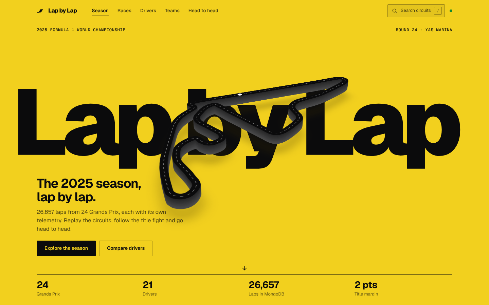
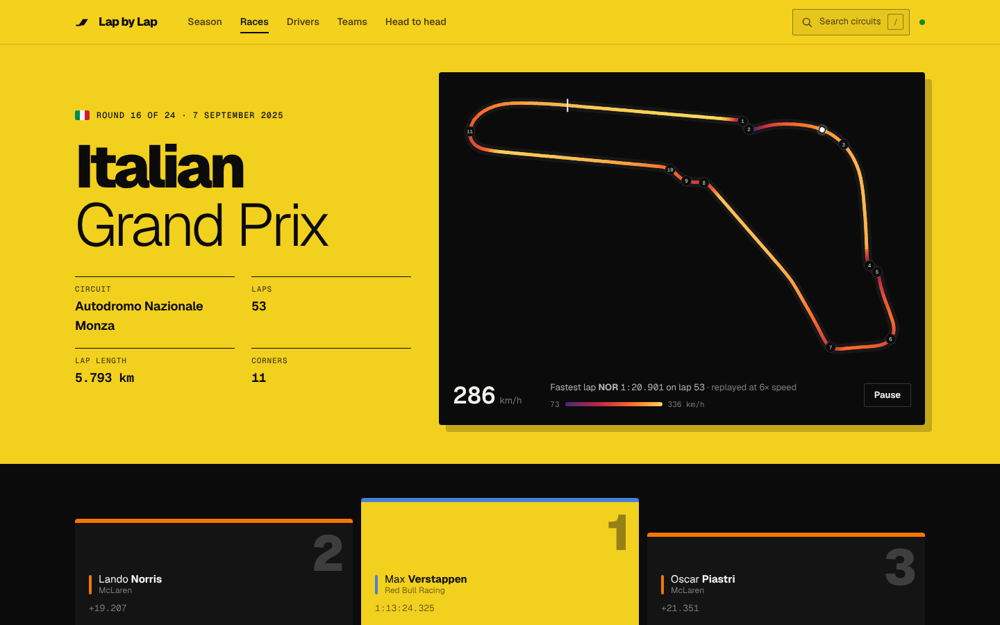
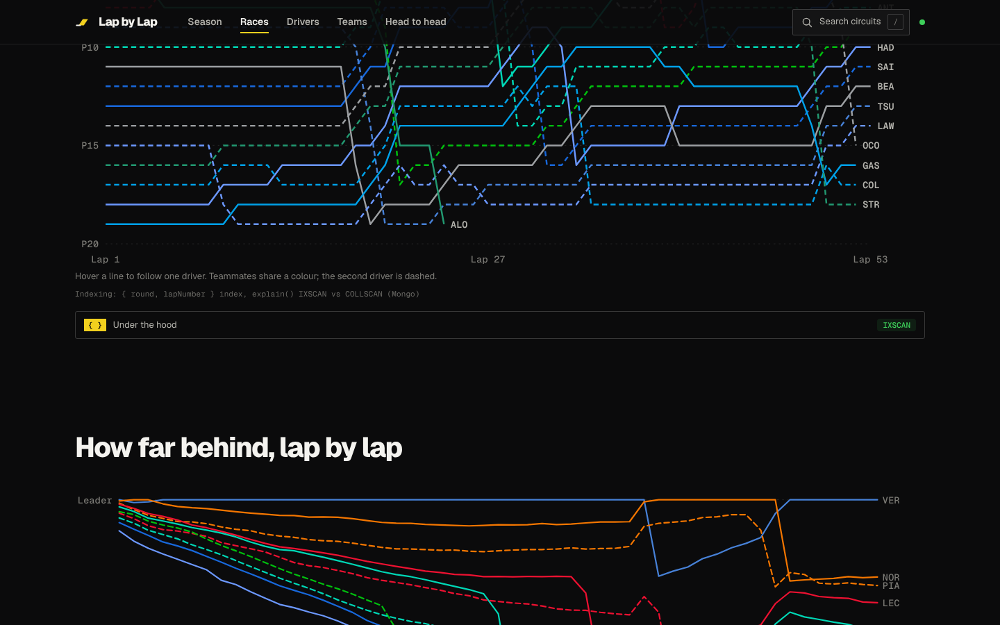
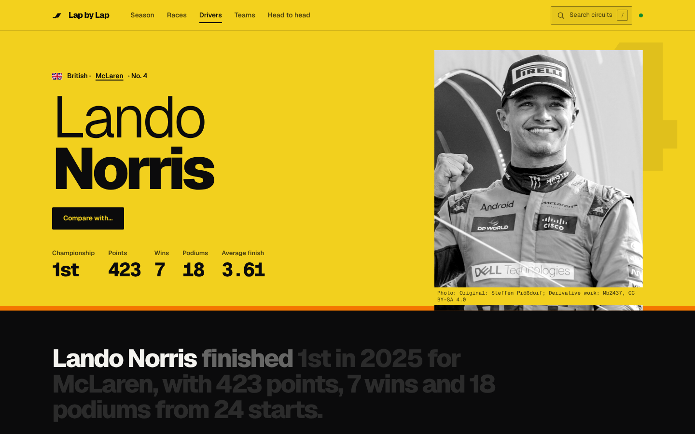
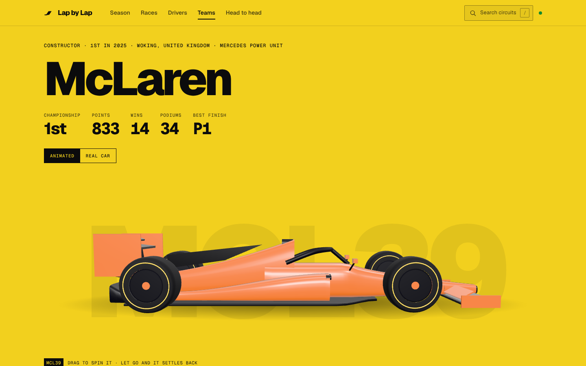
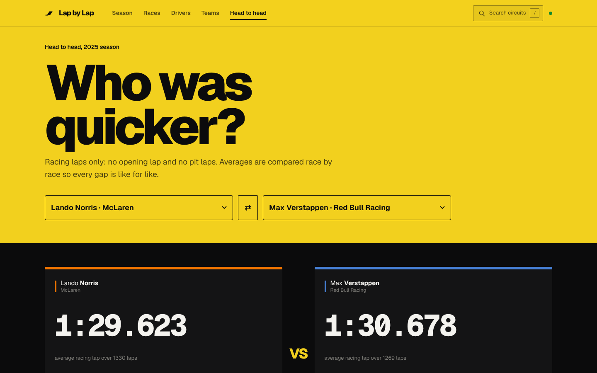
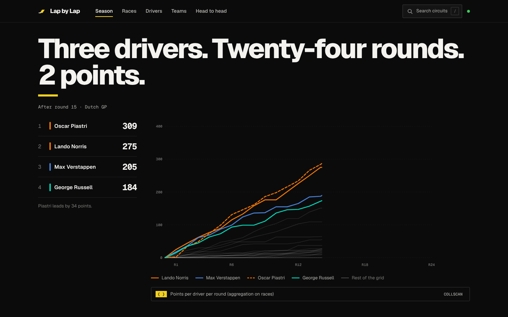

# Lap by Lap

**Every lap of the 2025 Formula 1 season, explorable in the browser.**

Lap by Lap turns a full F1 season (24 Grands Prix, 21 drivers, 26,657 laps with car telemetry) into an interactive site. Replay each circuit from the car's GPS trace, follow the title fight round by round, dig into any driver's laps, spin each team's car in 3D and put two drivers head to head. Every chart can show the exact MongoDB query behind it.

**Live demo:** [lap-by-lap.onrender.com](https://lap-by-lap.onrender.com) (free hosting, so the first visit can take up to a minute to wake)



| | |
|---|---|
|  |  |
|  |  |
|  |  |

## Highlights

- **Season overview:** a points chart that draws itself as you scroll, the calendar, a world map of circuits, final standings and the biggest movers.
- **Race pages:** circuit replay, podium, position changes, gap to the leader, tyre strategy, pit stops, fastest laps and every lap of the race.
- **Driver and team profiles:** bios, past seasons, race-by-race results, consistency, theoretical best lap, teammate battles, tyre degradation and a draggable 3D car.
- **Head to head:** compare two drivers' race pace across the season, with a shareable link.
- **Steward mode:** add, edit, penalise and hide laps. Edited data is tagged and kept out of every statistic.
- **Search:** press `/` or `Ctrl+K` to jump to any circuit or driver.
- **Optional Google sign-in:** notes and edits carry your name and only you can change them.

## Tech stack

| Layer | Tools |
|---|---|
| Frontend | React 19, Vite, Motion, Lenis, anime.js, three.js, GSAP |
| Backend | Node.js, Express 5, official `mongodb` driver |
| Database | MongoDB 7 (aggregation pipelines, window functions, `$geoNear`, text search, transactions, schema validation) |
| Auth | Google OAuth 2.0 with server-side sessions |
| Tests | `node:test`, end to end against a real database |
| Hosting | Render (web service) + MongoDB Atlas |

## Architecture

```
Browser (React SPA)  ──fetch /api/*──▶  Express (server.js)  ──driver──▶  MongoDB
        ▲                                     │
        └──────── static files from dist/ ◀───┘
```

- One Node process serves both the JSON API and the built React app, so there is a single deployable service.
- On startup the server applies the schema validator, creates indexes and, if the database is empty, loads the season from `data/season-2025.json.gz` (about 2 seconds). No separate seed step is needed.
- **Collections:** `drivers`, `races` (results embedded, GeoJSON location), `laps` (references drivers and races, telemetry embedded), plus `notes`, `users` and `sessions`.

## Run it locally

You need [Docker Desktop](https://www.docker.com/products/docker-desktop/).

```bash
git clone https://github.com/AarushShetty346/motorsport-viz.git
cd motorsport-viz
docker compose up --build
```

Open **http://localhost:3000** once the terminal prints `Lap by Lap is running`.

**Or run Node yourself** (Node 20.19+), with only MongoDB in Docker:

```bash
docker compose up -d mongo
npm install
npm start          # builds the site, then starts the server
```

`npm run dev` gives live reload on port 5173 (keep `npm run serve` running for the API). `npm test` runs the test suite against the local database.

## Environment variables

| Variable | Default | Purpose |
|---|---|---|
| `MONGODB_URI` | `mongodb://localhost:27017` | MongoDB connection string (`MONGO_URI` also works) |
| `DB_NAME` | `motorsport` | Database name |
| `PORT` | `3000` | Port to listen on (Render sets this) |
| `PUBLIC_URL` | Render URL or localhost | Public address, used for the Google redirect |
| `GOOGLE_CLIENT_ID`, `GOOGLE_CLIENT_SECRET` | unset | Turn on Google sign-in. Without them the app runs with sign-in off. |

Copy `.env.example` to `.env` for local settings.

## Deploying (Render + MongoDB Atlas, both free)

`render.yaml` describes the service, so Render picks up the build and start commands automatically.

### 1. Create the database on Atlas

1. Sign in at **https://cloud.mongodb.com** and click **Create** to make a new cluster. Pick **M0 (Free)**, any region near you, and click **Create Deployment**.
2. It asks you to make a database user. Type a username, click **Autogenerate Secure Password**, **copy the password somewhere safe**, then click **Create Database User**.
3. In the left menu open **Network Access** and click **Add IP Address**, then **Allow Access from Anywhere** (`0.0.0.0/0`), then **Confirm**. Render's free servers don't have a fixed IP, so this is needed.
4. Go back to **Database / Clusters**, click **Connect** on your cluster, then **Drivers**. Copy the connection string. It looks like `mongodb+srv://<user>:<password>@cluster0.xxxxx.mongodb.net/`. Replace `<password>` with the password from step 2.

### 2. Create the web service on Render

1. In the Render dashboard click **New +** then **Blueprint**, and pick the `motorsport-viz` repo. Render reads `render.yaml`. (Or choose **Web Service** and set: Build command `npm ci --include=dev && npm run build`, Start command `node server.js`, Instance type **Free**.)
2. When it asks for **MONGODB_URI**, paste the connection string from Atlas step 4.
3. Click **Apply** / **Create**. The first build takes a few minutes.
4. Open the `https://....onrender.com` address Render shows. The first start loads the season into Atlas by itself, so there's nothing to seed by hand.
5. Paste that address into the **Live demo** line at the top of this README.

Free Render services sleep after about 15 minutes idle, so the first visit after a break takes up to a minute to wake.

### 3. Google sign-in on the live site (optional)

In the Google Cloud console, open your OAuth client and add:
- **Authorised JavaScript origin:** `https://<your-app>.onrender.com`
- **Authorised redirect URI:** `https://<your-app>.onrender.com/api/auth/google/callback`

Then add `GOOGLE_CLIENT_ID` and `GOOGLE_CLIENT_SECRET` under **Environment** on Render and redeploy. The app uses Render's URL automatically; set `PUBLIC_URL` only if you add a custom domain.

## Data sources

- Results, calendar, circuits and drivers: [F1DB](https://github.com/f1db/f1db) (CC BY 4.0).
- Laps and telemetry: [TracingInsights 2025](https://github.com/TracingInsights/2025) (Apache-2.0), from the official live-timing feed via [FastF1](https://github.com/theOehrly/Fast-F1).
- Circuit maps: each race's fastest-lap X/Y position trace.
- Photos: Wikimedia Commons, free licences, credited on the site.

`npm run data:build` rebuilds the season file from source (downloads about 4 GB).

## Project structure

```
server.js     Express API + serves the built site
db.js         connection, validator, indexes, season loading
auth.js       Google sign-in, users and sessions
web/src/      React app (pages, components, lib)
scripts/      data build, DB setup, photo fetch
data/         season-2025.json.gz
test/         end-to-end API tests
render.yaml   Render deployment
```

---

*Unofficial fan project. Not associated with Formula 1 or the FIA. F1 and related marks are trademarks of Formula One Licensing B.V.*
