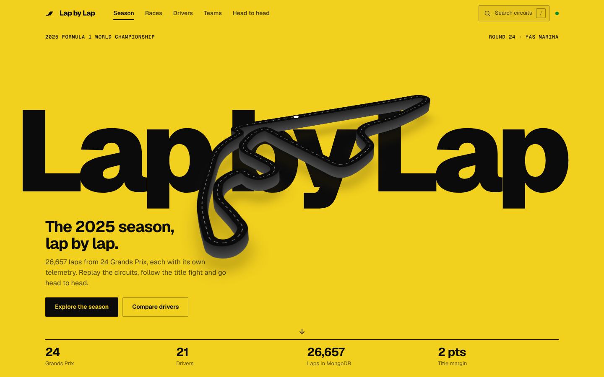
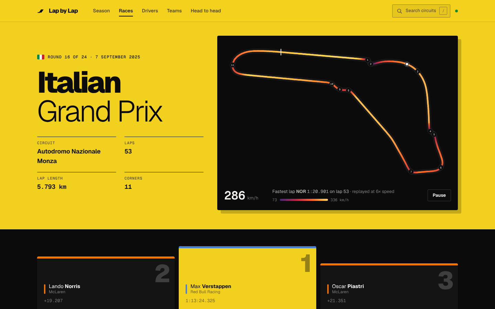
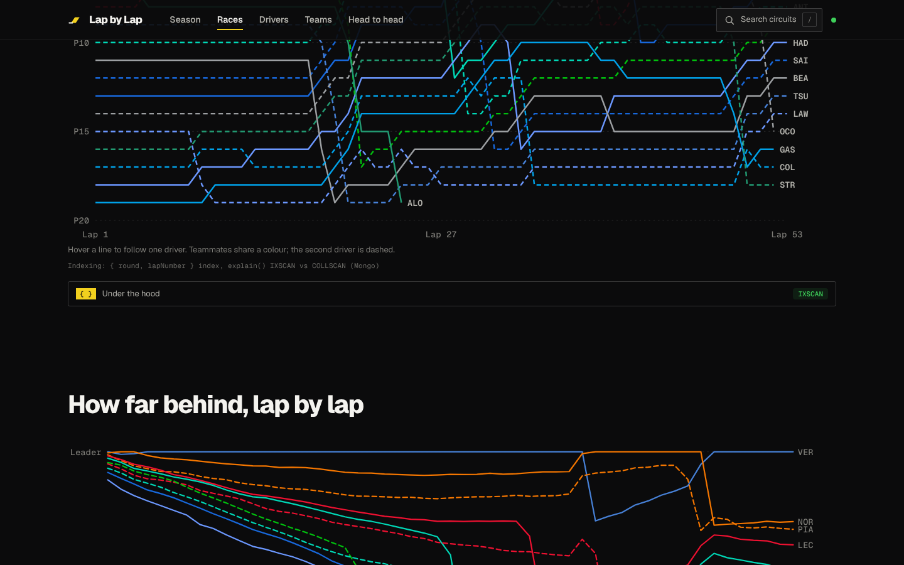
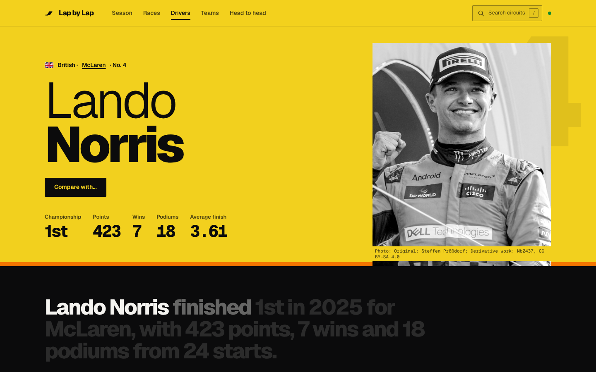
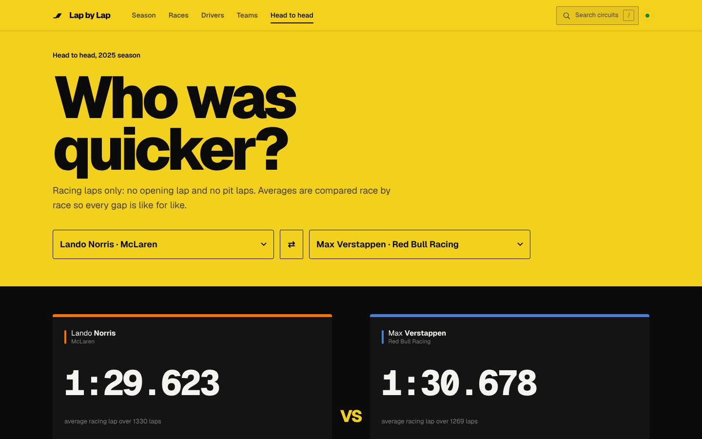
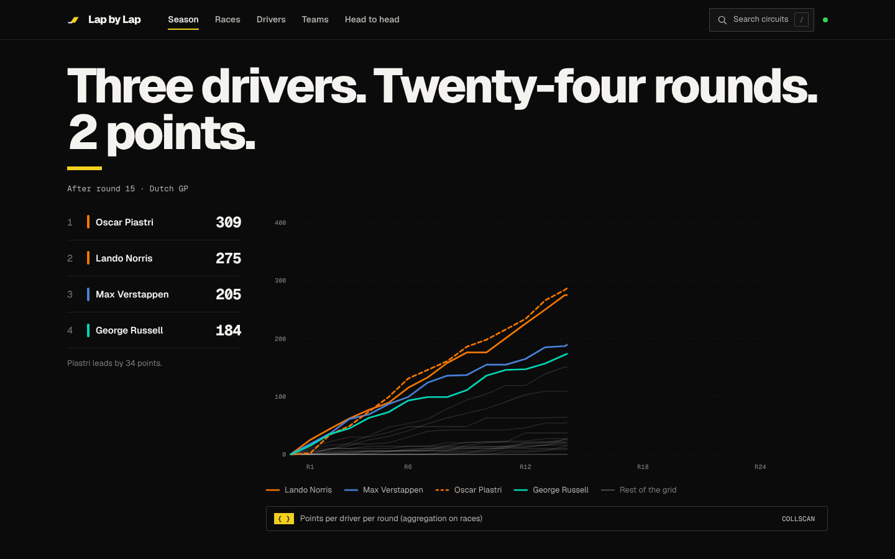

# Lap by Lap

**The 2025 Formula 1 season, every lap and every car, stored in MongoDB.**

Lap by Lap is a full-stack web app that turns a whole Formula 1 season into something you can explore. It holds the real 2025 season in a local MongoDB database: all 24 Grands Prix, 21 drivers and **26,657 laps**, and every lap carries its own car telemetry (top speed, peak RPM, throttle, braking, DRS). You can replay each circuit, follow the title fight round by round, dig into any driver's laps, look at each team's car and history, put two drivers head to head, and open up the exact MongoDB query behind every chart.



---

## What you can do on the site

| Page | What's on it |
|---|---|
| **Season** (`/`) | The hero, the title fight (a points chart that draws itself as you scroll), the 24-race calendar, a map of every circuit, the final driver and constructor standings, the season in one table, the biggest movers, the latest fan notes and a season-wide speed trap. |
| **Race** (`/race/16`) | The circuit drawn from the car's GPS trace, the podium, every position change, the gap to the leader lap by lap, "Race in numbers", the classification, the fastest-lap leaderboard, tyre strategy, pit stops, nearby circuits, fan notes and every lap of the race with **Steward mode**. |
| **Driver** (`/driver/lando-norris`) | The driver's profile (bio, past seasons and teams), championship stats, the 2025 season race by race, consistency, and a lap explorer: every lap of any race with its tyre, pit stops, telemetry and the theoretical best lap. |
| **Team** (`/team/mclaren`) | A 3D model of the team's car that you can drag around, the team profile (factory, history, team principal, notable people), its drivers, points round by round, the teammate battle and tyre degradation against the field. |
| **Head to head** (`/compare`) | Two drivers compared race by race on average racing-lap pace and who finished ahead each weekend, with a shareable link. |
| **Search** (press `/` or Ctrl+K) | Full-text search for a circuit (e.g. *monza*, *marina bay*), plus drivers by name. |

| | |
|---|---|
|  |  |
|  |  |
|  |  |

### MongoDB and user-defined features

There is no separate "features" page: every feature lives inside the normal pages, where it is actually useful. Under each one there is a small grey caption naming the feature and its type, for example *Aggregation: $group + $lookup (Mongo)* or *Head-to-head comparison (User)*, and an **Under the hood** drop-down that shows the exact query it ran and, for queries on `laps`, what `explain()` says (IXSCAN or COLLSCAN, documents examined, time).

Clicking any lap (in the Race page lap table, the Driver page lap explorer or a speed trap) opens a drawer with that lap's raw MongoDB document.

| # | Feature | Page | Grey caption |
|---|---|---|---|
| M1 | CRUD | Race > Lap by lap (Steward mode) | CRUD: insertOne, find, updateOne, deleteOne (Mongo) |
| M2 | Aggregation | Home standings, Driver season stats, Driver/Team profile | Aggregation: $group + $lookup (Mongo) |
| M3 | Indexing | Race > Race story | Indexing: { round, lapNumber } index, explain() (Mongo) |
| M4 | Schema validation | Race > Steward mode lap form | Schema validation: $jsonSchema (code 121) (Mongo) |
| M5 | Embedded + referencing | Race > click any lap (drawer) | Embedded documents + referencing (Mongo) |
| M6 | Update operators | Race > Steward mode | Update operators: $inc, $set, updateMany (Mongo) |
| M7 | Transactions | Race > Steward mode penalty | Transactions (Mongo) |
| M8 | $facet + $bucket | Race > Race in numbers | $facet + $bucket (Mongo) |
| M9 | Window functions | Race > Gap to leader | Window functions: $setWindowFields (Mongo) |
| M10 | Geospatial | Home circuit map, Race > Nearby circuits | Geospatial: 2dsphere / $geoNear (Mongo) |
| M11 | View | Driver > Consistency | View: clean_laps (Mongo) |
| M12 | $merge | Home > Season in one table | $merge: season_summary (Mongo) |
| M13 | TTL index | Compare > Share this comparison | TTL index: shared links expire after 7 days (Mongo) |
| M14 | Update operators on notes | Race > Fan notes | Update operators: $inc, $set, $addToSet, updateMany (Mongo) |
| M14 | Capped collection | Home > Latest notes | Capped collection: notes_feed (Mongo) |
| U1 | All laps for a driver | Driver > pick a race | All laps for a driver (User) |
| U2 | Head to head | Compare | Head-to-head comparison (User) |
| U3 | Fastest lap leaderboard | Race > Fastest laps | Fastest lap leaderboard (User) |
| U4 | Speed threshold | Race and Home > Speed trap slider | Speed threshold: speed trap (User) |
| U5 | Search by circuit | Search box (press /) | Search by circuit: $text index (User) |
| U6 | Tyre strategy | Race > Tyre strategy | Tyre strategy chart (User) |
| U7 | Pit stops | Race > Pit stops | Pit stop analysis (User) |
| U8 | Biggest movers | Race and Home | Biggest movers (User) |
| U9 | Theoretical best lap | Driver | Theoretical best lap (User) |
| U10 | Tyre degradation | Team | Tyre degradation (User) |
| U11 | Driver consistency | Driver | Driver consistency (User) |
| U12 | Teammate battle | Team | Teammate battle (User) |

### Steward mode and "not real" data

The **Every lap** table on each Race page has a **Steward mode** switch. With it on you can add, edit, penalise, hide and delete laps:

- A lap added in Steward mode is stored with `source: "steward"`. It shows in purple with an **(added)** tag.
- A real lap a steward changes (edit or penalty) gets `stewardEdited: true` and an orange **(edited)** tag.
- Steward laps appear in the lap tables but are left out of every leaderboard, standing, fastest lap, chart and statistic.
- Real laps can't be deleted, only hidden (`deleted: true`). Hidden laps disappear from every page and query; in Steward mode they show greyed out with a **Restore** button.
- **Reset demo data** (in the Steward mode bar) reloads the whole season and undoes every steward change.


---

## Metrics

Measured on the production build (`npm start`) with MongoDB 7 in Docker, on a Linux test machine (7 October 2026). Numbers on your own laptop will differ a little.

**Tests and build**

| Check | Result |
|---|---|
| API test suite (`npm test`) | **21 / 21 passing** in 7.7 s, against a real MongoDB |
| Production build (`npm run build`) | Builds in **1.9 s** |
| Main JavaScript bundle | 572 kB (**178 kB gzipped**) |
| 3D car bundle (loaded only on Team pages) | 613 kB (155 kB gzipped) |
| CSS | 64 kB (14 kB gzipped) |

**Lighthouse** (desktop, scores out of 100)

| Page | Performance | Accessibility | Best practices | SEO | First paint | Largest paint | Blocking time |
|---|---|---|---|---|---|---|---|
| Season `/` | **97** | 93 | 96 | 91 | 0.9 s | 1.1 s | 10 ms |
| Race `/race/16` | 86 | **97** | 96 | 91 | 0.9 s | 1.7 s | 0 ms |
| Driver `/driver/lando-norris` | 87 | 94 | 96 | 92 | 0.8 s | 1.6 s | 0 ms |

**API load test** ([autocannon](https://github.com/mcollina/autocannon), 50 connections for 10 seconds, zero errors)

| Endpoint | Requests / s | Median latency | p97.5 | p99 |
|---|---|---|---|---|
| `GET /api/races/16` (one race) | **1,144** | 42 ms | 67 ms | 75 ms |
| `GET /api/health` | 966 | 48 ms | 88 ms | 100 ms |
| `GET /api/season/standings` (aggregation over 24 races) | 236 | 205 ms | 379 ms | 427 ms |
| `GET /api/drivers/:id/stats` (aggregation over a driver's laps) | 236 | 205 ms | 323 ms | 355 ms |
| `GET /api/races/16/laps` (all 974 laps of a race) | 68 | 722 ms | 910 ms | 966 ms |

**Index proof** (`explain("executionStats")` on `db.laps.find({ round: 16 }).sort({ lapNumber: 1 })`)

| Plan | Stage | Documents examined | Returned | Time |
|---|---|---|---|---|
| With the `{ round: 1, lapNumber: 1 }` index | IXSCAN + FETCH | **974** | 974 | 2 ms |
| Forced full scan (`hint({ $natural: 1 })`) | COLLSCAN | 26,657 | 974 | 22 ms |

The index makes MongoDB read 27 times fewer documents and answer about 10 times faster.

---

## Tech stack

- **Database:** MongoDB 7, running in Docker as a single-node replica set (needed for transactions). No cloud account, no sign-up.
- **Backend:** Node.js + Express 5, talking to MongoDB with the official `mongodb` driver.
- **Frontend:** React 19, built with Vite. Smooth scrolling with [Lenis](https://github.com/darkroomengineering/lenis), scroll-linked animation with [Motion](https://motion.dev), circuit replays with [anime.js](https://animejs.com) motion paths and the 3D cars with [three.js](https://threejs.org).
- **Tests:** Node's built-in `node:test`, end to end against a real database.

---

## Run it on your laptop

**You need:** [Docker Desktop](https://www.docker.com/products/docker-desktop/) installed and running. That's all. Node.js and MongoDB both run inside Docker.

1. Open a terminal.
2. Download the project and go into its folder:
   ```bash
   git clone https://github.com/AarushShetty346/motorsport-viz.git
   cd motorsport-viz
   ```
3. Start everything:
   ```bash
   docker compose up --build
   ```
4. Wait until the terminal prints `Lap by Lap is running at http://localhost:3000`, then open **http://localhost:3000** in your browser.

What happens on the first start:

- MongoDB starts as a single-node replica set (`rs0`, needed for transactions); the healthcheck runs `rs.initiate()` once.
- The server creates the `laps` collection with its `$jsonSchema` validator, creates the indexes, adds GeoJSON locations to the circuits, and loads the 2025 season from `data/season-2025.json.gz` into MongoDB (about 2 seconds). You'll see this in the terminal.
- Stop it with `Ctrl+C`. Start it again later with `docker compose up`.
- The data is kept in a Docker volume between runs. To wipe it and reload the season, turn on **Steward mode** on any Race page and click **Reset demo data**, or run `docker compose down -v` and start again.

> **Offline note:** the *first* `docker compose up --build` needs internet once, to download the `mongo:7` and `node:22-alpine` images and the npm packages. After that everything runs fully offline, including the fonts and the season data. **Run it once before your demo** while you're online.

### Option B: MongoDB in Docker, Node.js on your laptop

Use this if you have Node.js 20.19 or newer installed and want to run the server yourself.

1. Start only MongoDB:
   ```bash
   docker compose up -d mongo
   ```
2. Install the packages (first time only):
   ```bash
   npm install
   ```
3. Build the website and start the server:
   ```bash
   npm start
   ```
   (`npm start` builds the React app into `dist/` and then starts Express.) Open **http://localhost:3000**.

While you're changing the website, `npm run dev` gives you live reload on http://localhost:5173 (keep `npm run serve` running in a second terminal for the API).

### Handy commands

| Command | What it does |
|---|---|
| `docker compose up --build` | Start MongoDB + the app (the one command) |
| `docker compose down` | Stop everything (keeps the data) |
| `docker compose down -v` | Stop and **delete** the data volume (reloads the season next start) |
| `npm start` | Build the website, then start the server (Option B) |
| `npm run dev` | Website with live reload on port 5173 (needs the server running) |
| `npm run db:setup` | Set up the database by hand: start the replica set if needed, apply the validator, create the indexes and circuit locations, load the season |
| `npm run shell` | Open `mongosh` inside the MongoDB container, on the `motorsport` database |
| `npm test` | Run the API test suite (needs MongoDB on localhost:27017) |
| `npm run data:build` | Re-download and rebuild the season file (see section 4) |

Useful things to type in `mongosh` during a demo:

```js
db.laps.countDocuments()                                   // 26657
db.laps.find({ round: 16 }).limit(2)                        // Monza laps
db.laps.getIndexes()
db.getCollectionInfos({ name: "laps" })[0].options.validator
db.laps.insertOne({ circuit: "Monza" })                     // -> Document failed validation
rs.status().set                                             // "rs0"
db.laps.find({ $text: { $search: "silverstone" } }).count()
db.races.findOne({ round: 24 }, { results: { $slice: 3 }, track: 0 })
```

### Troubleshooting

- **"port is already allocated" for 27017:** another MongoDB is already running. Stop it, or change `"27017:27017"` to `"27018:27017"` in `docker-compose.yml`.
- **Port 3000 in use:** change `"3000:3000"` to e.g. `"8080:3000"` in `docker-compose.yml` and open http://localhost:8080 (or `PORT=8080 npm start` for Option B).
- **"Cannot connect to the Docker daemon":** start Docker Desktop and wait until it says it's running.
- **The server keeps printing "MongoDB not reachable yet":** MongoDB isn't running. Start it (see above). The server retries for about 2.5 minutes before giving up.
- **The page says the web app hasn't been built:** you ran `node server.js` directly. Run `npm start` (or `npm run build` once) instead.

### Sign in with Google (optional)

The site has a **Sign in** button (top right) that lets people log in with their Google / Gmail account. Once sign-in is on:

- **Anyone can browse** every page, chart and stat without signing in.
- **Writing needs a sign-in.** Adding Fan notes, marking them helpful, tagging, Steward mode (adding, editing, hiding or penalising laps), resetting the demo data and making share links all show a "Sign in with Google" box instead of the form until you sign in. The server enforces this too: those requests answer `401` when nobody is signed in.
- **Everything you add carries your name.** Notes use your Google name (you can't type someone else's), and notes and laps store `addedBy: { userId, name }` in MongoDB. Real laps you change remember `lastEditedBy`.
- **Only you can edit or delete what you added.** Other people see your notes and laps but get no Edit or Delete buttons (the server answers `403` if they try anyway).
- **My activity** (in the menu under your photo, or `/me`) lists your notes, the laps you added and the real laps you changed.

**Without Google keys, sign-in is off** and the app behaves as before: anyone can add, edit and delete, and Fan notes use the name typed in the form. So the app still runs for anyone who clones it without setting anything up. The button only appears once you've given the app a Google "client ID" and "client secret". Getting them is free and takes about five minutes:

1. Go to **https://console.cloud.google.com** and sign in with your Google account.
2. At the top, click the project picker, then **New project**. Call it `Lap by Lap` and click **Create**. Make sure the new project is selected.
3. In the left menu open **APIs & Services → OAuth consent screen** (newer consoles call it **Google Auth Platform → Branding**). Click **Get started**, fill in:
   - **App name:** `Lap by Lap`
   - **User support email:** your Gmail address
   - **Audience:** *External*
   - **Contact email:** your Gmail address

   then click **Create**.
4. Open **Audience** (or **Test users** on older consoles) and click **Add users**. Add every Gmail address that should be able to sign in while the app is in "Testing" mode (yours, plus anyone you'll demo with).
5. Open **Clients** (or **APIs & Services → Credentials → Create credentials → OAuth client ID**) and click **Create client**:
   - **Application type:** *Web application*
   - **Name:** `Lap by Lap local`
   - **Authorised JavaScript origins:** `http://localhost:3000`
   - **Authorised redirect URIs:** `http://localhost:3000/api/auth/google/callback`

   Click **Create**. Google shows a **Client ID** and a **Client secret**. Copy both.
6. In the project folder, copy the example settings file and paste your two values into it:
   ```bash
   cp .env.example .env
   ```
   (Windows: `copy .env.example .env`.) Open `.env` in any text editor and replace `your-client-id...` and `your-client-secret` with the values from step 5.
7. Restart the app (`Ctrl+C`, then `docker compose up --build`, or `npm start`). The terminal now prints `Google sign-in is on`, and a **Sign in** button appears in the top bar.

Things to know:

- `.env` holds a secret, so it is in `.gitignore` and never gets committed. Each laptop that runs the app needs its own `.env`.
- If you open the app at a different address (another port, or a hosted URL), set `PUBLIC_URL` in `.env` to that address and add `<that address>/api/auth/google/callback` as another redirect URI in step 5. Google's error **"redirect_uri_mismatch"** means these two don't match.
- Signed-in people are stored in MongoDB too: a `users` collection (one document per Google account) and a `sessions` collection with a **TTL index** that makes MongoDB delete each session automatically after 30 days. Try `db.users.find()` in `npm run shell`.

---

---

## How it works

### Data model

Three collections in the `motorsport` database hold the season (plus `users` and `sessions` for [Sign in with Google](#sign-in-with-google-optional)).

**`drivers`** (21 documents)

```js
{ _id: ObjectId("..."), key: "lando-norris", code: "NOR", name: "Lando Norris",
  firstName: "Lando", lastName: "Norris", number: 4, team: "McLaren", teamColor: "#F47600",
  nationality: "British", countryCode: "GB", dateOfBirth: "1999-11-13" }
```

**`races`** (24 documents). Each race embeds its classification (and sprint classification) as arrays of sub-documents, the circuit trace used for the maps, and the circuit's location as GeoJSON.

```js
{ _id: ObjectId("..."), round: 16, name: "Italian Grand Prix", circuit: "Monza",
  circuitFullName: "Autodromo Nazionale Monza", country: "Italy", date: "2025-09-07", laps: 53,
  location: { type: "Point", coordinates: [9.289444, 45.620556] },   // 2dsphere index
  results: [ { position: 1, driverId: ObjectId("..."), team: "Red Bull Racing", grid: 1, points: 25, ... }, ... ],
  sprint: null,
  track: { x: [...], y: [...], speed: [...], lap: { code: "NOR", lapNumber: 53, lapTime: 80.901 } },
  corners: [ { number: 1, x: ..., y: ... }, ... ] }
```

**`laps`** (26,657 documents), validated by `$jsonSchema`. Required: `driverId`, `lapNumber`, `lapTime`, `telemetry` (with types and ranges checked). `source` may only be `"steward"`; `stewardEdited` and `deleted` must be booleans.

```js
{
  _id: ObjectId("..."),
  driverId: ObjectId("..."),   // reference -> drivers._id
  raceId: ObjectId("..."),     // reference -> races._id
  round: 16, race: "Italian Grand Prix", circuit: "Monza", country: "Italy",
  lapNumber: 53, lapTime: 80.901, position: 2,
  compound: "HARD", stint: 2, tyreLife: 29, pitIn: false, pitOut: false,
  deleted: false,              // true only when a steward hides the lap
  timeDeleted: false,          // true when the FIA struck off the lap time for track limits (still a real lap)
  sectors: { s1: 26.6, s2: 27.1, s3: 27.2 },   // embedded
  telemetry: { speed: 336.0, avgSpeed: 257.8, rpm: 11912, throttle: 81.3, brake: 10.9, drs: 21.4, gear: 8, speedTrap: 331 }
  // Steward mode only: source: "steward", stewardEdited: true, penaltySeconds: 5
}
```

**Indexes on `laps`:** `_id` (default), `{ driverId: 1, lapNumber: 1 }` (Driver page), `{ round: 1, lapNumber: 1 }` (Race page) and `{ circuit: "text" }` (search). `races` has a unique index on `round` and a `2dsphere` index on `location`; `drivers.key` is unique.

**Replica set:** MongoDB runs as a single-node replica set called `rs0`, because multi-document transactions (the steward penalty) need one. `docker compose up` starts it with `--replSet rs0` and the healthcheck runs `rs.initiate()` the first time.

---

## Where the data comes from

All of it is real and free to reuse:

- **Race results, points, calendar, circuits and drivers:** [F1DB](https://github.com/f1db/f1db) (CC BY 4.0).
- **Every lap and its telemetry:** the [TracingInsights 2025 archive](https://github.com/TracingInsights/2025) (Apache-2.0), which is built from the official F1 live-timing feed via [FastF1](https://github.com/theOehrly/Fast-F1). For each lap the raw car data (several hundred samples) is summarised into top speed, peak RPM, throttle, braking and DRS figures.
- **Circuit maps:** the car's own X/Y position trace on each race's fastest lap, so every map is exactly the line the car drove.

The ready-made file `data/season-2025.json.gz` (about 1 MB) is in the repo, so you don't need to download anything. To rebuild it yourself (Python 3.9+ and `pip install pyyaml`; it downloads about 4 GB of telemetry and takes 15-45 minutes):

```bash
npm run data:build
```

### Hero photo

The home page hero is designed around a podium photo. Put a free-licensed photo at `web/public/img/podium.jpg` (Wikimedia Commons has real F1 podium champagne photos you can reuse: search [Formula 1 podium champagne](https://commons.wikimedia.org/w/index.php?search=Formula+1+podium+champagne&title=Special:MediaSearch&type=image)), then fill in the author, licence and link in `web/src/content.js`. The credit line appears on the photo and in the footer. Until a photo is there, the hero shows the Abu Dhabi circuit instead.

### Driver photos

The driver pages show a head-and-shoulders photo when one is in `web/public/img/drivers/`. To fetch free-licensed photos (CC BY, CC BY-SA, CC0 or public domain only) from Wikimedia Commons for every driver:

```bash
npm run photos:fetch
```

It writes `web/public/img/drivers/credits.json` with each photo's author, licence and source link, and the credit is shown under the photo. Drivers without a photo get a portrait card with their initials in team colour.

### Teams and cars

The **Teams** page lists all ten 2025 teams, each with its car drawn in the team's livery and its drivers. Each team page shows that car in 3D. The colours live in `web/src/lib/teams.js`.

---

## Tests

`npm test` (21 tests) starts the real server against a throwaway `motorsport_test` database, loads the full season and checks every feature: CRUD and the validator's code 121 rejection, Steward mode, the penalty transaction, the indexes and `explain()`, standings, head to head, the leaderboard, the speed threshold, text search, the `$facet`, window-function, stint, pit stop, movers, theoretical best, tyre degradation and `$geoNear` queries, and reset. It needs MongoDB running (`docker compose up -d mongo`).

---

## Project structure

```
motorsport-viz/
├── docker-compose.yml   # mongo:7 as replica set rs0 (healthcheck initiates it, volume) and the app
├── Dockerfile           # builds the website, then runs the Express server
├── .env.example         # Google sign-in settings (copy to .env)
├── package.json         # npm start / dev / test / data:build
├── server.js            # Express API (one endpoint group per functionality) + serves the website
├── auth.js              # Sign in with Google (OAuth) + users/sessions collections
├── db.js                # connection + retry, $jsonSchema validator, indexes, circuit locations, loads the season
├── data/
│   └── season-2025.json.gz   # the 2025 season (results, circuits, 26,657 laps with telemetry)
├── scripts/
│   ├── setup-db.js      # npm run db:setup: replica set, validator, indexes, circuit locations, seed
│   └── build_season.py  # rebuilds the season file from F1DB + TracingInsights
├── vite.config.mjs      # builds web/ into dist/
├── web/
│   ├── index.html
│   ├── public/          # favicon, img/ (hero photo goes here)
│   └── src/
│       ├── App.jsx      # routes, smooth scrolling, page transitions
│       ├── pages/       # Home, Race, Driver, Team, Compare
│       ├── components/  # TrackMap, TitleFight, Calendar, RaceTrace, Leaderboard, SearchPalette, ...
│       ├── lib/         # API client, router, formatting, circuit geometry
│       └── styles.css
└── test/
    └── api.test.js      # end-to-end API tests (node:test)
```

### API reference

| Method & path | Feature |
|---|---|
| `GET /api/health`, `GET /api/drivers`, `GET /api/races`, `GET /api/races/:round`, `POST /api/reset` | every page, Reset demo data |
| `GET /api/races/:round/laps` | race story chart, N3 explain() |
| `GET /api/laps?round=&driverId=&page=&limit=&steward=1`, `GET /api/laps/:id`, `POST /api/laps`, `PUT /api/laps/:id`, `DELETE /api/laps/:id` | N1 CRUD, N4 validation, N5 lap drawer |
| `PATCH /api/laps/:id/hidden`, `POST /api/races/:round/restore` | N6 update operators |
| `POST /api/laps/:id/penalty` | N6 `$inc` + N10 transaction |
| `GET /api/drivers/:id/stats`, `GET /api/season/standings`, `GET /api/season/progression`, `GET /api/season/constructors`, `GET /api/teams/:team/season` | N2 aggregation |
| `GET /api/races/:round/numbers` | N7 `$facet` + `$bucket` |
| `GET /api/races/:round/gaps` | N8 `$setWindowFields` |
| `GET /api/races/:round/nearby` | N9 `$geoNear` |
| `GET /api/user/driver-laps/:driverId?round=`, `GET /api/drivers/:id/season` | U1 |
| `GET /api/user/compare?a=&b=` | U2 |
| `GET /api/user/leaderboard?round=` | U3 |
| `GET /api/user/speed?min=&round=` | U4 |
| `GET /api/user/search?q=` | U5 |
| `GET /api/races/:round/stints` | U6 |
| `GET /api/races/:round/pitstops` | U7 |
| `GET /api/movers?round=` | U8 |
| `GET /api/drivers/:id/theoretical?round=` | U9 |
| `GET /api/teams/:team/degradation` | U10 |
| `GET /api/auth/me`, `GET /api/auth/google`, `GET /api/auth/google/callback`, `POST /api/auth/logout` | Sign in with Google |

*Unofficial fan project. Not associated with Formula 1 or the FIA. F1 and related marks are trademarks of Formula One Licensing B.V.*
